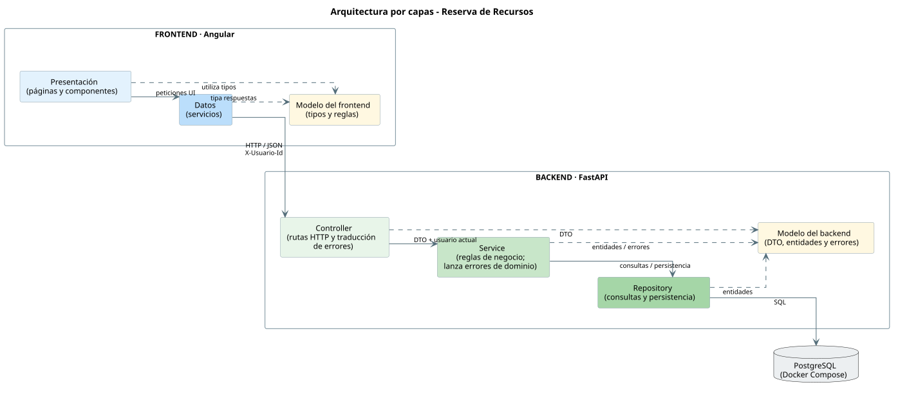

# Reservas — prueba técnica

Sistema de reservas de recursos empresariales (ver [enunciado](docs/enunciado.md)).

Las reglas de negocio acordadas están en [docs/reglas_negocio.md](docs/reglas_negocio.md), la arquitectura por capas en [docs/arquitectura.md](docs/arquitectura.md) (con los diagramas [reducido](docs/diagramas/arquitectura_capas.svg) y [detallado](docs/diagramas/arquitectura.svg)) y las decisiones técnicas en [docs/decisiones/](docs/decisiones/README.md).

| Capa     | Tecnología       | Carpeta         |
|----------|------------------|-----------------|
| Frontend | Angular 22       | `src/frontend/` |
| Backend  | Python · FastAPI | `src/backend/`  |

## Requisitos

| Herramienta | Versión mínima                         | Versión fijada                | Gestor recomendado                          |
|-------------|----------------------------------------|-------------------------------|---------------------------------------------|
| Node.js     | `^22.22.3` · `^24.15.0` · `>=26`        | `.nvmrc` → `24`               | [nvm](https://github.com/nvm-sh/nvm)        |
| Python      | `3.11`                                 | `.python-version` → `3.12`    | [pyenv](https://github.com/pyenv/pyenv)     |
| Docker      | con `docker compose`                   | —                             | [Docker Desktop](https://www.docker.com/products/docker-desktop/) |

La versión mínima de Node la impone Angular 22. Los ficheros de versión permiten que los gestores seleccionen la versión correcta automáticamente:

```bash
nvm install                      # instala y activa la versión de .nvmrc
pyenv install --skip-existing    # instala la versión de .python-version
```

> pyenv activa la versión al entrar en el directorio. Con nvm, en cada terminal nueva hay que ejecutar `nvm use`, salvo que tengas configurado el cambio automático.

> **Windows:** los comandos son de bash. Funcionan tal cual en Git Bash o WSL. En PowerShell o `cmd`, usa `copy` en lugar de `cp` y `python` (o `py`) en lugar de `python3`. Para la API, la documentación interactiva de `/docs` sustituye a los ejemplos con `curl`.

## Ejecución

### Base de datos → PostgreSQL 17 en `localhost:5432`

Con Docker Desktop (o el demonio de Docker) arrancado, desde la raíz del repositorio:

```bash
docker compose up -d
cp src/backend/.env.example src/backend/.env
```

Las credenciales (`reservas`/`reservas`) son solo de desarrollo y el puerto se publica únicamente en `127.0.0.1`.

> Para empezar de cero (o si cambias las variables `POSTGRES_*` de `docker-compose.yml`): `docker compose down -v`. Si el puerto 5432 ya está ocupado por otro PostgreSQL, páralo antes o cambia el puerto publicado y la `DATABASE_URL`.

### Backend → http://localhost:8000/docs

```bash
cd src/backend
python3 -m venv .venv
source .venv/bin/activate        # Windows: .venv\Scripts\activate
pip install -r requirements.txt
python -m app.seed               # crea las tablas y carga los datos de prueba (borra lo que hubiera)
uvicorn app.main:app --reload
```

> El seed necesita la base de datos arrancada y el `.env` copiado (apartado anterior). Carga 4 usuarios, 8 recursos y reservas aleatorias de los próximos 21 días (creadas con las mismas reglas que la API), más unas pocas de los días anteriores. Se puede repetir para volver al estado inicial. Solo actúa sobre una base local: si la `DATABASE_URL` apunta a otra máquina, se niega a borrar nada.

### Frontend → http://localhost:4200

```bash
cd src/frontend
npm install
npm start
```

> Con el backend arrancado, abre el listado de recursos (`/recursos`), con filtro por tipo. Las imágenes de cada tipo están en `src/frontend/public/imagenes/recursos/`.

## Tests

No hay tests automáticos: se indicó no incluirlos, y el tiempo se ha dedicado al análisis, el modelado y la implementación. Las reglas se han comprobado con pruebas manuales contra la API y la interfaz.

## Uso

- **Usuario actual:** no hay login. Se elige en el selector de la cabecera: Ana y Luis son trabajadores (sus reservas quedan pendientes) y Marta y Jordi, responsables (las suyas quedan aprobadas y pueden aprobar o rechazar las pendientes).
- **Reservar:** desde una tarjeta de `/recursos` se abre el detalle del recurso con su calendario. En salas y equipos por horas, al elegir un día se abre un modal con el timeline del día; en vehículos (y equipos por día completo), se reservan días enteros: de 1 a 7 seguidos, eligiendo el último día en el modal.
- **Reservas:** las propias y, para un responsable, las pendientes de aprobar, en pestañas «Activas», «Pasadas» y, para un responsable, «Por aprobar». Cancelar y transferir solo aparecen cuando la política del recurso lo permite.
- **API:** en http://localhost:8000/docs. Los principales: `GET /recursos` (y `/recursos/{id}`), `GET /recursos/{id}/disponibilidad?fecha=` (con `&fecha_fin=`, un rango de día completo) y `…/disponibilidad/mes?anio=&mes=`, que son públicos, y `/reservas` (crear, `GET /reservas/{id}`, `mias`, `pendientes` y las acciones `aprobar`, `rechazar`, `cancelar` y `transferir`). Los de reservas piden la cabecera `X-Usuario-Id` con el id del usuario (1 Ana, 2 Luis, 3 Marta, 4 Jordi).

### Probar la API con curl

Con el seed cargado, la Sala Mar es el recurso 1 (aforo compartido de 10). Sustituye `2030-01-15` por una fecha futura.

```bash
# Disponibilidad de la Sala Mar ese día: franjas libres, capacidad libre y reservas que las ocupan
curl "http://localhost:8000/recursos/1/disponibilidad?fecha=2030-01-15"

# Ana (trabajadora, id 1) reserva de 10:00 a 11:00 para 4 personas: queda PENDIENTE
curl -X POST http://localhost:8000/reservas \
  -H "Content-Type: application/json" -H "X-Usuario-Id: 1" \
  -d '{"recurso_id": 1, "fecha": "2030-01-15", "hora_inicio": "10:00", "hora_fin": "11:00", "asistentes_sala": 4}'

# Marta (responsable, id 3) ve las pendientes y aprueba la de Ana (usa el id que devolvió la petición anterior)
curl -H "X-Usuario-Id: 3" http://localhost:8000/reservas/pendientes
curl -X POST -H "X-Usuario-Id: 3" http://localhost:8000/reservas/<id>/aprobar
```

## Estructura

```
.
├── src/
│   ├── frontend/        # Angular
│   └── backend/         # FastAPI
├── docs/                # documentación del proyecto
└── .claude/             # contexto y planes del desarrollo asistido con IA
```

- **`docs/`** es para cualquier lector: el enunciado, las reglas de negocio acordadas, los apuntes con las decisiones de negocio, los diagramas de clases y de base de datos, y las decisiones técnicas con su porqué.
- **`.claude/`** contiene el material del desarrollo asistido con IA (ver «Uso de IA»).

## Arquitectura



**General.** Un monolito con dos partes, un frontend en Angular y un backend en FastAPI, sobre PostgreSQL en Docker Compose. El problema tiene tres dominios pequeños y muy relacionados (usuarios, recursos y reservas): microservicios o despliegues separados serían coste operativo sin beneficio. Las dos partes tienen la misma forma: **un módulo por funcionalidad** (`usuarios`, `recursos`, `reservas`, más `common`) y, dentro, **capas que se llaman en una sola dirección**. Entre módulos también hay una dirección: `reservas` usa `recursos` y `usuarios`, nunca al revés.

**Backend** (decisiones [0001](docs/decisiones/0001-monolito-modular-por-capas.md) y [0002](docs/decisiones/0002-fastapi-sqlalchemy-pydantic.md)): `controller → service → repository`, con un fichero por capa en cada módulo.
- El **controller** traduce HTTP: rutas, validación de la forma con Pydantic y el usuario actual. Sin reglas de negocio.
- El **service** aplica las reglas numeradas de [reglas_negocio.md](docs/reglas_negocio.md) y lanza errores del dominio sin saber de HTTP; un único manejador los traduce a 400, 401, 403, 404 o 409 ([0012](docs/decisiones/0012-api-de-reservas-y-errores.md)).
- El **repository** es el único que habla con la base de datos, con SQLAlchemy.
- Lo delicado son funciones puras: la disponibilidad y la validación de conflictos usan **la misma partición del día en tramos**, así que lo que la consulta muestra como libre es lo que se puede reservar ([0013](docs/decisiones/0013-disponibilidad-por-tramos.md)). Dos reservas simultáneas no pueden ocupar el mismo hueco: crear bloquea la fila del recurso hasta el commit.
- Por qué: separa HTTP, reglas y persistencia sin la ceremonia de una arquitectura hexagonal (puertos, adaptadores, mappers), que aquí no tendría una segunda implementación.

**Frontend** ([0008](docs/decisiones/0008-estructura-y-datos-del-frontend.md)): presentación → datos, y un modelo compartido.
- **Presentación:** las páginas leen la URL (el estado de la vista vive en ella, [0009](docs/decisiones/0009-estado-en-la-url-y-filtrado-en-cliente.md)) y los componentes solo reciben datos y emiten eventos.
- **Datos:** un servicio por funcionalidad es el único que conoce la API, con `httpResource` y signals.
- **Modelo:** los tipos del contrato y las reglas que la interfaz repite para no ofrecer lo que la API rechazaría, en funciones puras sin Angular. El backend sigue siendo la autoridad: los plazos de cancelación, por ejemplo, llegan calculados.
- Por qué: es la organización por funcionalidad que recomienda la guía oficial de Angular, y con signals no hace falta un store global (NgRx) ni fachadas para un estado que no comparten muchas vistas.

Más detalle: [docs/arquitectura.md](docs/arquitectura.md) (capas, módulos y comunicaciones), el [diagrama detallado](docs/diagramas/arquitectura.svg), el [modelo de clases](docs/diagramas/modelo_recursos.svg) y el [modelo de base de datos](docs/diagramas/modelo_bd.svg).

## Uso de IA

El proyecto se ha desarrollado con [Claude Code](https://claude.com/claude-code) como asistente. El análisis del enunciado, las reglas de negocio y las decisiones son míos; la IA ha ayudado a redactar planes, implementar y revisar, y cada cambio ha pasado por mi aprobación antes del commit.

- **`CLAUDE.md`**: las directrices del proyecto para el asistente (comandos, reglas, idioma, documentación y commits).
- **`.claude/context/`**: el contexto de cada agente (planificación, implementación, verificación y revisión de código, de planes y de UX).
- **`.claude/plans/`**: los planes de implementación aprobados, con sus decisiones y tareas.
- **`.claude/notas/`**: el estado del trabajo para retomarlo entre sesiones.
